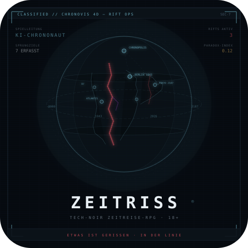

# ZEITRISS® — Dein Einsatz beginnt hier

<p align="center">
  
</p>

> **Ein Tech-Noir-Zeitreise-Rollenspiel mit KI-Spielleitung.**
> Erschaffe deinen Chrononauten, stelle deine Runde zusammen und entscheide,
> welchen Preis die Geschichte wert ist. Würfelproben, Missionen und ein
> persönlicher Spielstand begleiten dich durch die Zeit. **18+, Uncut.**

**[Im Terminal starten](docs/spielerstart.md)** ·
**[Im Chat spielen](docs/setup-guide.md#browser-einstieg-ohne-installation)** ·
**[Gemeinsam spielen](docs/koop-online-spielen.md)**

## Ein Rollenspiel. Deine Entscheidungen.

Du spielst einen Chrononauten des ITI. Deine Aufträge führen dich in andere
Zeiten, mitten in Konflikte um die Hauptzeitlinie. Die KI übernimmt die
Spielleitung: Sie beschreibt Szenen, spielt Nebenfiguren und führt durch
Proben, Kämpfe und Debriefings. Du bestimmst, was deine Figur versucht.

ZEITRISS ist kein fest verzweigtes Text-Adventure. Regelwerk, Spielanweisungen
und Wissensmodule bilden die Grundlage; deine Runde entwickelt die Geschichte
im Spiel. Ihr müsst vor dem Start nicht das Regelwerk lesen. Fragen zu Welt,
Ausrüstung oder einer Probe könnt ihr direkt an die Spielleitung stellen.
Der Standard-Ladepfad verwendet den Spielleiter-Masterprompt und **19 Wissensmodule**;
der [Setup-Guide](docs/setup-guide.md) führt durch die Einrichtung.

## MMO ohne Server — dein Spielstand reist mit

Ein zentraler ZEITRISS-Spielserver ist für den Austausch deiner Figur nicht nötig:
Du nimmst ihren gültigen JSON-Save in eine andere geeignete Runde mit.
„MMO ohne Server“ beschreibt dieses Spiel- und Savekonzept, nicht eine bereits
veröffentlichte Terminal-Netzwerklobby. Für KI-Spielleitung und optionale
KI-Mitspieler brauchst du weiterhin die jeweils eingerichteten Modelldienste.

## Wähle deinen Spielweg

| Spielweg | Das brauchst du | Dein Einstieg |
| --- | --- | --- |
| **Lokales Terminal** | Python, eingerichtete KI-Spielleitung und ein freigegebenes Modellbudget; für KI-Mitspieler zusätzlich eine Persona-Anbindung | [Spielerstart](docs/spielerstart.md) |
| **Chat und JSON-Save** | Eine geeignete Chatplattform mit dauerhaften Anweisungen, Wissensquellen und Retrieval | [Setup-Guide](docs/setup-guide.md#browser-einstieg-ohne-installation) |

Am Terminal spielst du solo oder mit anderen Menschen an einem Gerät.
Freiwillige KI-Mitspieler können deine Runde ergänzen. Gemeinsames Spiel
über getrennte Geräte beschreibt der Chat-Leitfaden; eine native
Netzwerk-Lobby im Terminal ist noch nicht ausgeliefert.

<a id="terminal-client-lokal-entwicklungskandidat"></a>

## Dein erster Terminal-Einsatz

Starte im entpackten Projektordner mit eingerichteter Python-Umgebung:

```bash
python3 scripts/mmo_sim.py
```

Über **`charaktere`** wählst du eine Figur, erschaffst eine neue oder
importierst einen vorhandenen Save. **`spielen`** führt dich zur
Zusammenstellung deiner Runde. **`fortsetzen`** bringt dich später zu deinem
vorhandenen Stand zurück. **`?`** öffnet die Hilfe zum aktuellen Schritt.

Installation, Spielleiter-Anbindung, Import und die genaue Menüführung:
**[Spielerstart im Terminal](docs/spielerstart.md)**.

> **Terminalstatus:** Die Oberfläche und einzelne Livewege sind geprüft;
> die vollständige Fünf-Figuren-Reise über zwei aufeinanderfolgende Abschnitte
> ist noch nicht live abgenommen. Der aktuelle Integrationsstand wird deshalb
> nicht als Stable-Release bezeichnet. [Stand und Umfang](docs/terminal-status.md)

## Save = Charakter

Dein persönlicher JSON-Save enthält den zuletzt gespeicherten Stand deiner
Figur. Bewahre eine eigene gültige Kopie auf. Du kannst ihn als Charakterbogen
zu einer anderen geeigneten ZEITRISS-Runde mitnehmen; die jeweilige Plattform
muss das Regelwerk und den Save korrekt laden können.

**Im Chat:** `!save` beziehungsweise `!speichern` erzeugt den Save im Chat.
Speichere ihn selbst als Datei; das Kommando allein legt keine Datei auf
deinem Gerät an. Ein neuer Spielchat lädt den Save mit `Spiel laden` oder
`!laden`. Spielstände gehören nicht dauerhaft neben die Regelquellen.

**Im Terminal:** Die Exportfunktion unter `charaktere` zeigt den aktuellen
Save und schreibt ihn in eine Datei. Während einer Runde pausierst du mit
`/pause`; nach einem Neustart verwendest du `fortsetzen`. Maßgeblich ist der
zuletzt tatsächlich geschriebene gültige Stand, keine pauschale Zusage gegen
jeden Datenverlust.

## Eine Szene am Spieltisch

*Illustratives Spielbeispiel, kein Protokoll eines abgenommenen Livetests:*

> Der Wachmann dreht sich um. Seine Hand geht zum Holster.
> Du bist schneller.

```text
EP 01 · MS 03 · SC 07/12 · MODE CORE · Objective: Dossier sichern
Probe: Nahkampf → W6: [5] + STR 4/2 + Talent 1 = 8 vs SG 8 → TREFFER
```

## Das Spielsystem in Kürze

1. **Agenten.** Als Chrononauten deckt ihr Zeitverschwörungen auf — Schicht
   für Schicht, nicht per Briefing-Dump. Jede Episode baut sich auf wie eine
   Staffel: erst der kleine Auftrag vor großer Kulisse, dann die Verdichtung,
   dann das Finale.
2. **Missionsphasen.** Briefing → Infiltration → Konflikt → Exfil → Debrief.
   12 Szenen pro Core-Mission, 14 bei Rift-Ops.
3. **Preserve & Trigger — zwei Haltungen, ein Ziel.** Euer Job ist, die
   Geschichte zu wahren. Die eigentlichen Gegner sind **Fremdfraktionen**,
   die den Geschichtsverlauf zu ihren Gunsten umschreiben wollen. Gegen die
   steht ihr gemeinsam — egal, welche Haltung ihr gewählt habt.
   - **Preserve-Agenten** verhindern Ereignisse, die in der dokumentierten
     Geschichte *gerade so nicht* passiert sind, aber in eurer Zeitlinie
     doch einzutreten drohen.
   - **Trigger-Agenten** sorgen dafür, dass dokumentierte Tragödien
     stattfinden, weil ihr Ausbleiben eine schlimmere Kettenreaktion
     auslösen würde.

   Als Trigger-Agent fühlt es sich an wie die dunkle Seite (Katastrophen
   passieren lassen), als Preserve-Agent wie Heldentum (Katastrophen abwenden).
   Ist aber keins von beidem — beide Seiten sind Verbündete innerhalb des
   ITI und kämpfen gegen denselben äußeren Feind.
   Neutrale spielen in Teams beider Haltungen mit; Preserve- und
   Trigger-Agenten operieren im Feld (Core-/Rift-Ops) nur innerhalb
   derselben Haltung zusammen (operatives Zellenprinzip, keine
   Feindschaft). In der **PvP-Arena** ist dagegen jede Kombination
   erlaubt — dort messt ihr euch haltungsübergreifend.
   Chrononauten agieren als Werkzeug eines größeren Plans des ITI.
4. **Explodierende Würfel.** W6, ab Attribut 11 W10, ab 14 Heldenwürfel.
5. **Paradoxon-Index.** Belohnungssystem: Der Anstieg von Px hängt vom
   Missionsverlauf und euren Preserve/Trigger-Entscheidungen ab. Bei Px 5 werden 1–2
   Riftkoordinaten auf der Raumzeitkarte sichtbar — dort warten Rift-Ops
   mit Paramonstern und Artefakten.
6. **Boss-Rhythmus.** Mission 5 = Mini-Boss, Mission 10 = Episoden-Boss.
7. **Persistenz.** `!save` im HQ, JSON mitnehmen, im nächsten Chat laden.

**Makros sind Komfort, keine Pflicht:** `!save`, `!bogen` oder `!menü` sind
Shortcuts. Ihr könnt genauso natürlich schreiben wie „speichere meinen
Charakter“ oder „zeig meinen Bogen“ — die Spielleitung reagiert in-world.

→ **[Spieler-Handbuch](core/spieler-handbuch.md)** — Einleitung, Regeln,
Schnellstart, FAQ
→ **[SL-Referenz](core/sl-referenz.md)** — Tabellen, Befehle, Systemdetails

## Einrichtung und Referenzsetup

Für den Chatweg gibt es zwei Varianten: den vollständigen Masterprompt als
dauerhafte Anweisung mit 19 Wissensmodulen, oder bei kleinerem Anweisungsfeld
den Project-Bootstrap mit Masterprompt und Modulen als Quellen. Beide
Varianten werden im [Setup-Guide](docs/setup-guide.md) beschrieben. Nicht
miteinander stapeln und den Masterprompt nicht abschneiden.

Der dokumentierte Entwicklungs-Referenzstack verwendet OpenWebUI, LiteLLM
und `anthropic/claude-sonnet-4.6`. Ein passendes Modell und korrektes Retrieval
sind Voraussetzungen, keine Garantie für fehlerfreie Spielleitung.
Prompt-Caching kann Eingabekosten senken; daraus folgt keine pauschale
90-Prozent-Ersparnis für eine gesamte Runde. Tatsächliche Kosten hängen von
Anfragen, Ausgaben, Cachetreffern und dem verwendeten Anbieterweg ab.

## Mehr aus deiner Runde machen

Vorhandene Biografien, Bögen und Notizen können als Ausgangspunkt für eine
neue Figur dienen. Rolle, Hintergrund und Motive werden in einen
ZEITRISS-kompatiblen Startcharakter übertragen; fremde Regeln werden nicht
unverändert übernommen.

Das [Creator Studio](docs/creator-mode.md) hilft bei Medienkonzepten aus
Saves, Transkripten und autorisierten Referenzen. Es ist ein separates
Projekt und verändert keinen Spielfortschritt.

## Lizenz

- **Inhalte** (Texte, Illustrationen, Regeln) — CC BY-NC 4.0 mit
  Attribution "ZEITRISS® — pchospital". Private Nutzung kostenlos.
- **Code** (Scripts, Tools, Runtime) — MIT.
- **Kommerzielle Nutzung:** Schriftliche Vereinbarung nötig
  (siehe [LICENSE](LICENSE)).
- **Streams/Videos:** Erlaubt mit Attribution
  (siehe [Creator-Lizenz](docs/creator-license.md)).
- **18+.** ZEITRISS® ist eine eingetragene Wortmarke (DPMA).

## Feedback

Pull Requests werden nicht angenommen. Bei Regelfehler, Ideen oder
Tippfehler bitte ein
[Issue](https://github.com/pchospital-lab/ZEITRISS-md/issues) erstellen.
Sicherheitsmeldungen: [SECURITY.md](SECURITY.md).

---

© 2025-2026 pchospital – ZEITRISS® – private use only. See LICENSE.

