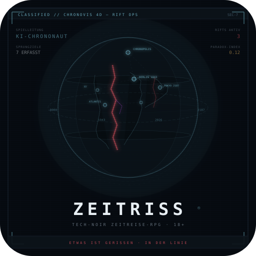

# ZEITRISS® — Dein Einsatz beginnt hier

<p align="center">
  
</p>

> **Ein Tech-Noir-Zeitreise-Rollenspiel mit KI-Spielleitung.**
> Erschaffe deinen Chrononauten, stelle deine Runde zusammen und entscheide,
> welchen Preis die Geschichte wert ist. **18+, Uncut.**

**[Im Terminal starten](docs/spielerstart.md)** ·
**[Im Chat spielen](docs/setup-guide.md#browser-einstieg-ohne-installation)** ·
**[Gemeinsam spielen](docs/koop-online-spielen.md)**

## Was du spielst

ZEITRISS ist ein textbasiertes Rollenspiel mit KI-Spielleitung: Du spielst einen
Chrononauten des ITI, handelst in freier Sprache, und eine KI führt Szene,
Figuren und Würfe. Du spielst solo, mit Menschen an einem Gerät oder mit
optionalen KI-Mitspielern — deine Figur bleibt als Save erhalten. Wie du
startest, steht in den Links oben. So fühlt sich ein echter Zug an:

## So spielt sich das im Terminal

Kein Werbetext, sondern ein gekürzter Original-Spieltext aus dem R4-Kampagnenlauf
(Duo-Tisch, Episode 1, Infiltration einer Raffinerie). Zwei Chrononauten holen ein
Originaldokument aus dem gesicherten Trakt: MAHLBERG (Leitung) zieht den Aufseher
mit einem Fachgespräch nach vorn, BREACH nimmt in der entstehenden Lücke still
das Papier. So stimmen sich deine Mitspieler ab, so entscheidet das Würfelsystem,
so spricht der Kodex. Textauszug aus dem Spiellauf — keine Bildschirmaufnahme;
Markdown-Betonung für die Anzeige entfernt, jede Auslassung mit […] markiert, der
Wortlaut ist nicht verändert:

```text
[…]
BREACH: Sauer dreht sich zur Leuchte, Rücken zum D-Trakt, das Original liegt sechs Meter hinter ihm auf dem Tisch. Die Spielleitung hat das Fenster explizit mir gegeben. […] Ich gehe nicht in dem Moment, in dem er sich dreht. Ich gehe eine halbe Sekunde später — wenn er anfängt zu reden. […] Das Papier zuerst, der Mann danach.

MAHLBERG: Option 2. Ich ziehe ihn nach vorn. […] „Kommen Sie mal mit nach vorne. Zwölf Meter, ich zeig's Ihnen." […] Ein Mann, dem man sagt, dass sein Fachgebiet an dieser Stelle einen Fehler hat, kommt mit. Er will es sehen. Und er diskutiert, weil Fachleute diskutieren, und jedes Wort, das er diskutiert, ist Breachs Zeit.

EP 1 · MS 1 · SC 03/12 · PHASE Infil · MODE CORE · COMMS OK · Px 0/5 · Obj: Rheinau-D-2011 sichern · Exfil: T-18:00
MAHLBERG LP 10/10 · Stress 0/10 · 👁️ verdeckt — Social aktiv
BREACH LP 10/10 · Stress 0/10 · 👁️ verdeckt

Kodex: Probe-Template — Systemnaht erkennen / CHA · W6 + ⌊CHA 2/2⌋ + Talent +2.
Probe: Sauer zur Fuge ziehen → W6: [4] + 1 + 2 = 7 vs SG 6 → ERFOLG
Kodex: Probe-Template — Stilles Entnehmen / GES · W6 + ⌊GES 3/2⌋ (SG reduziert durch aktive Ablenkung).
Probe: BREACH Original sichern → W6: [5] + 1 = 6 vs SG 4 → ERFOLG

[…] Er greift nach rechts, hebt den blauen Deckel — und darunter liegt Rheinau-D-2011. Handschrift, schwarz, zwei Seiten, gefaltet. […]

Kodex: Rheinau-D-2011 Original — gesichert. Adresse identifiziert: Ludwigshafener Str. 14, 2. OG, Eingang B · 20:00 Uhr · heute. Zweite Handschrift — nicht Sauer, nicht Kessmann (unbekannt). Blatt liegt noch auf dem Tisch.
```

Im nächsten Zug liest MAHLBERG das zurückgebliebene zweite Blatt aus — und der
Würfel explodiert:

```text
EP 1 · MS 1 · SC 04/12 · PHASE Intel · MODE CORE · COMMS OK · Px 0/5 · Obj: Rheinau-D-2011 ✓ · Exfil: T-18:00
MAHLBERG LP 10/10 · Stress 0/10 · 👁️ getarnt
BREACH LP 10/10 · Stress 0/10 · 👁️ verdeckt

Kodex: Probe-Template — Prüfprotokolle lesen / INT · W6 + ⌊INT 6/2⌋ + Talent +2 · SG 5 (Sauer präsent, abgelenkt, kein Zeitdruck).
Probe: Dokument einordnen → W6: [6] + 3 + 2 = 11 vs SG 5 → ERFOLG (Exploding: [3] → 14) → KRITISCH

[…]

Kodex: Kritischer Erfolg — […] Adresse vollständig notiert. Keine Firmenidentifikation möglich — Notizbuch ist privat. […]
```

Das ist kein Menü mit Knöpfen. Deine Mitspieler — am selben Terminal oder als
KI-Personas — stimmen sich in eigenen Worten ab, du handelst in freier Sprache, und
wenn es drauf ankommt, entscheidet ein Wurf: `1W6`, plus halbes Attribut, plus
Talent, gegen einen Schwierigkeitsgrad. Eine `6` explodiert und würfelt nach (hier
`11 → 14`, ein kritischer Erfolg). Der Kodex ist die Stimme des Spiels — er sagt
dir, was dein Zug bewirkt hat, nicht, was du tun sollst. Hier fällt kein Schuss:
Täuschung und ein ruhiger Griff holen das Dokument, ein kritischer Wurf liest die
zweite Spur aus. Das ist ZEITRISS — tech-noir, kalt, präzise, erwachsen.

Dieser Ausschnitt stammt aus dem lokal abgenommenen R4-Kampagnenlauf; es ist ein
gekürzter Spieltext, kein Terminal-Screenshot. Herkunft, Prüfsummen und die Grenze
zur echten Bildschirmaufnahme:
[Terminalstatus § Showcase-Szenen](docs/terminal-status.md#showcase-szenen--herkunft).

### Und wenn es doch eng wird — Solo, Episode 1

Dieselbe Mechanik, andere Tonlage. Ein Solo-Chat-Playtest, Rostock 1973, ein
Lagerraum im Hafenspeicher — ein erster Konfliktzug mit echtem Spielerinput:
Initiative, ein Fernkampf mit explodierendem Würfel, ein Treffer, der sitzt. Runde
eins endet offen; die Verfolgung läuft danach weiter. Unverändert, […] markiert
jede Kürzung:

```text
EP 1 · MS 2 · SC 5/12 · PHASE Konflikt · MODE CORE · COMMS JAM · Lvl 2 ▓▓░░░░░░░░ 0/1 XP · Px 1/5 · Stress 0/10 · Obj: Liste + Hartmann · Exfil — · 💀 Konflikt

Untergeschoss · Lagerraum · 21:54 Uhr

[…] Du nimmst die Pistole raus, Sicherung weg, und trittst gegen das untere Drittel der Tür.

Sie fliegt auf.

[…] Zwei Männer — Mitte vierzig, zivil gekleidet, einer mit Lederjacke, einer mit grauem Wollpullover. Auf dem Tisch: Papiere, eine offene Aktentasche, und mittendrin ein gefaltetes Dokument das aussieht wie das was du suchst. […]

Lederjacke hat reflexartig die Hand zur Hüfte bewegt. Er ist bewaffnet.

[…]

Initiative.
Initiative → W6: [4] + max(GES 5, TEMP 2) = 9
Lederjacke Initiative → W6: [3] + 3 = 6
Wollpullover Initiative → W6: [1] + 2 = 3

Du bist zuerst.

Runde 1 — Dein Zug.
Lederjacke ist die Bedrohung. Seine Hand ist schon auf dem Weg zur Waffe.
Probe: Fernkampf → W6: [6] + W6: [3] (Exploding) + GES 5/2 = 11 vs SG 7 → ERFOLG

Du schießt einmal — nicht auf Masse, auf die Schulter. […] seine Waffe — eine Makarov — fällt klappernd auf den Boden. Er sackt an der Wand runter, Schulter, lebt, aber er ist raus.
Kodex: Lederjacke — 3 LP Schaden. Kampfunfähig.

[…]

Wollpullover — sein Zug.

Er entscheidet sich nicht für Kampf. Er entscheidet sich für den Tisch — greift nach der Aktentasche, reißt das gefaltete Dokument rein, schnappt den Griff.
Probe: Wollpullover Flucht → W6: [5] + 2 = 7 vs SG 6 → ERFOLG

Er hat die Tasche. Er dreht sich zur hinteren Wand — dort, wo du es im Grundriss nicht gesehen hast — eine zweite Tür, schmal, halb hinter einem Regal versteckt. Er tritt sie auf.

[…]

Kodex: Magazin 11/12. Noise: kritisch. Zeitfenster kollabiert.
```

Ein `MISS` oder ein geglückter Wurf wird nicht wegretuschiert — Kompetenz ist keine
Garantie. Runde eins endet mit offener Lage: ein Gegner ist raus, der zweite bricht
mit der Aktentasche zu einer versteckten Tür durch, und du nimmst die Verfolgung
auf. Wie es weitergeht, hängt an den nächsten Würfen und deinen Entscheidungen —
genau das meint „deine Entscheidungen zählen“.

## Wer bist du in dieser Verschwörung?

ZEITRISS hat keine klassischen Bösewichte. Ihr seid Chrononauten des ITI, und
euer Job ist, die Geschichte zu wahren. Die eigentlichen Gegner sind
**Fremdfraktionen**, die den Geschichtsverlauf zu ihren Gunsten umschreiben —
gegen die steht ihr gemeinsam, egal, welche Haltung ihr gewählt habt.

- **Preserve-Agenten** verhindern Ereignisse, die in der dokumentierten
  Geschichte *gerade so nicht* passiert sind, aber in eurer Zeitlinie doch
  einzutreten drohen. Fühlt sich an wie Heldentum — Katastrophen abwenden.
- **Trigger-Agenten** sorgen dafür, dass dokumentierte Tragödien stattfinden,
  weil ihr Ausbleiben eine schlimmere Kettenreaktion auslösen würde. Fühlt sich
  an wie die dunkle Seite — Katastrophen passieren lassen.

Beides ist weder Held noch Schurke: zwei Haltungen, ein gemeinsamer äußerer
Feind. Im Feld (Core-/Rift-Ops) operiert ihr innerhalb derselben Haltung
zusammen; in der **PvP-Arena** ist jede Kombination erlaubt. Die moralische
Zwickmühle ist kein Beiwerk — sie ist der Kern.

## Ein Rollenspiel. Deine Entscheidungen.

Du spielst einen Chrononauten des ITI. Deine Aufträge führen dich in andere
Zeiten, mitten in Konflikte um die Hauptzeitlinie. Die KI-Spielleitung
beschreibt die Szene, spielt die Figuren darin und führt die Proben — aber was
deine Figur versucht, bestimmst du, in freier Sprache. Kein fest verzweigtes
Text-Adventure: Ihr müsst vor dem Start nicht das Regelwerk lesen. Fragen zu Welt,
Ausrüstung oder einer Probe stellst du direkt an die Spielleitung. Wie du die
Spielleitung einrichtest, zeigt der [Setup-Guide](docs/setup-guide.md).

## MMO ohne Server — dein Spielstand reist mit

Deine Figur gehört dir als Datei: Du nimmst ihren gültigen JSON-Save in jede
andere geeignete Runde mit — ein zentraler Spielserver ist dafür nicht nötig.
„MMO ohne Server" meint dieses Save-Konzept (für KI-Spielleitung und
KI-Mitspieler brauchst du weiterhin die eingerichteten Modelldienste), keine
fertige Netzwerklobby.

## Wähle deinen Spielweg

| Spielweg | Das brauchst du | Dein Einstieg |
| --- | --- | --- |
| **Lokales Terminal** | Python und eine eingerichtete KI-Spielleitung | [Spielerstart](docs/spielerstart.md) |
| **Chat und JSON-Save** | Eine geeignete Chatplattform mit dauerhaften Anweisungen und Wissensquellen | [Setup-Guide](docs/setup-guide.md#browser-einstieg-ohne-installation) |

Am Terminal spielst du solo oder mit anderen Menschen an einem Gerät;
freiwillige KI-Mitspieler können deine Runde ergänzen. Gemeinsames Spiel über
getrennte Geräte beschreibt der [Chat-Leitfaden](docs/koop-online-spielen.md).
Die genauen Voraussetzungen je Weg stehen im verlinkten Guide.

<a id="terminal-client-lokal-entwicklungskandidat"></a>

## Dein erster Terminal-Einsatz

Starte im entpackten Projektordner mit eingerichteter Python-Umgebung:

```bash
python3 scripts/mmo_sim.py
```

Über **`charaktere`** wählst du eine Figur, erschaffst eine neue oder
importierst einen vorhandenen Save. **`spielen`** führt dich zur
Zusammenstellung deiner Runde. **`fortsetzen`** bringt dich später zu deinem
vorhandenen Stand zurück. **`?`** öffnet die Hilfe zum aktuellen Schritt.
Installation, Spielleiter-Anbindung, Import und Menüführung:
**[Spielerstart im Terminal](docs/spielerstart.md)**.

<details>
<summary>Terminalstatus — lokale Beta (Abnahmestand)</summary>

Der lokale R4-Speicher- und Fortsetzungsweg ist im beschriebenen Umfang
unabhängig abgenommen (29. Oktober 2026): fünf Figuren in einem Duo und einem
Trio mit je zwei geschlossenen Runden; abschließend wurden fünf Endsaves in
einem frischen Prozess geladen und eine wirksame Duo-Folgeaktion belegt.
Die oben gezeigten Spielszenen sind gekürzte Original-Spieltexte — der
Team-Zug aus dem abgenommenen R4-Kampagnenlauf, der Solo-Beat aus einem
historischen Chat-Playtest. Herkunft und Prüfsummen im
[Terminalstatus](docs/terminal-status.md#showcase-szenen--herkunft).
Eine echte Terminal-Bildschirmaufnahme (Icons, Farben, Umbruch) ist noch nicht
Teil dieser Belege und für spätere Terminal-UX-Playtests vorgesehen.
[Stand und Grenzen](docs/terminal-status.md)

</details>

## Das Spielsystem in Kürze

1. **Agenten.** Als Chrononauten deckt ihr Zeitverschwörungen auf — Schicht für
   Schicht, nicht per Briefing-Dump. Jede Episode baut sich auf wie eine Staffel:
   erst der kleine Auftrag vor großer Kulisse, dann die Verdichtung, dann das Finale.
2. **Missionsphasen.** Briefing → Infiltration → Konflikt → Exfil → Debrief.
   12 Szenen pro Core-Mission, 14 bei Rift-Ops.
3. **Proben & explodierende Würfel.** `1W6 + ⌊Attribut/2⌋ + Talent + Gear` gegen
   einen Schwierigkeitsgrad — oben in Aktion zu sehen. Eine `6` explodiert und
   würfelt nach; ab Attribut 11 wird aus dem W6 ein W10, ab 14 der Heldenwürfel.
4. **Paradoxon-Index.** Belohnungssystem: Px steigt mit Missionsverlauf und
   euren Preserve/Trigger-Entscheidungen. Bei Px 5 werden 1–2 Riftkoordinaten
   sichtbar — dort warten Rift-Ops mit Paramonstern und Artefakten.
5. **Boss-Rhythmus.** Mission 5 = Mini-Boss, Mission 10 = Episoden-Boss.
6. **Persistenz.** `!save` im HQ, JSON mitnehmen, in der nächsten Runde laden.

→ **[Spieler-Handbuch](core/spieler-handbuch.md)** — Einleitung, Regeln,
Schnellstart, FAQ
→ **[SL-Referenz](core/sl-referenz.md)** — Tabellen, Befehle, Systemdetails

## Save = Charakter

Dein persönlicher JSON-Save enthält den zuletzt gespeicherten Stand deiner
Figur. Bewahre eine eigene gültige Kopie auf. Du kannst ihn als Charakterbogen
zu einer anderen geeigneten ZEITRISS-Runde mitnehmen; die jeweilige Plattform
muss das Regelwerk und den Save korrekt laden können.

**Im Chat:** `!save` beziehungsweise `!speichern` erzeugt den Save im Chat.
Speichere ihn selbst als Datei; das Kommando allein legt keine Datei auf deinem
Gerät an. Ein neuer Spielchat lädt den Save mit `Spiel laden` oder `!laden`.

**Im Terminal:** Freie Handlungen und Gespräche schreibst du als normale Sprache
— dafür brauchst du kein Kommando. Zum *zuverlässigen* Abschließen und Speichern
einer Runde sendet der Leader **im HQ `!save` (oder `!speichern`) als eigene,
einzelne Nachricht**; die Spielleitung gibt darauf deinen Stand als Save-Block
aus, den der Client erntet. „Speichere meinen Charakter" ist am Terminal *kein*
gleichwertiger Auslöser — die Save-Erkennung hängt am `!save`-Kommando und am
tatsächlichen Save-Block. Gespeichert wird nur im HQ; in Briefing, Einsatz und
Debrief ist Speichern gesperrt (SaveGuard). Maßgeblich ist der zuletzt
tatsächlich geschriebene gültige Stand, keine pauschale Zusage gegen jeden
Datenverlust.

Bleibt ein `!save` nach wiederholten Formatfehlern ohne gültigen Stand, kann das
Terminal den besten zulässigen Kandidaten als **Best-Effort-Abschluss** übernehmen
und die Runde schließen; eine verbleibende strukturelle Warnung ist dabei **kein**
bestandener Schema-Check, und der nächste Load bereinigt den Stand nicht garantiert
vollständig. Davon getrennt bewahrt ein **SAVECOMPAT**-Stand nicht direkt
übernehmbare Daten samt Herkunft auf — er ist selbst noch kein abgeschlossener
Abschnitt und keine Zusage gegen Datenverlust. Kurz erklärt unter
[Spielerstart](docs/spielerstart.md#best-effort-und-savecompat), technische Details:
`systems/gameflow/speicher-fortsetzung.md#kompatibilitaetsstand`.

## Einrichtung und Referenzsetup

Für den Chatweg gibt es zwei Varianten: den vollständigen Masterprompt mit
19 Wissensmodulen als dauerhafte Anweisung, oder bei kleinerem Anweisungsfeld den
Project-Bootstrap mit Masterprompt und Modulen als Quellen. Beide beschreibt der
[Setup-Guide](docs/setup-guide.md) — dort stehen auch der dokumentierte
Referenzstack, die Modellwahl und die Kostenhinweise. Nicht miteinander stapeln
und den Masterprompt nicht abschneiden. Ein passendes Modell und korrektes
Retrieval sind Voraussetzungen, keine Garantie für fehlerfreie Spielleitung.

## Mehr aus deiner Runde machen

Vorhandene Biografien, Bögen und Notizen können als Ausgangspunkt für eine neue
Figur dienen. Rolle, Hintergrund und Motive werden in einen ZEITRISS-kompatiblen
Startcharakter übertragen; fremde Regeln werden nicht unverändert übernommen.

Das [Creator Studio](docs/creator-mode.md) hilft bei Medienkonzepten aus Saves,
Transkripten und autorisierten Referenzen. Es ist ein separates Projekt und
verändert keinen Spielfortschritt.

## Lizenz

- **Inhalte** (Texte, Illustrationen, Regeln) — CC BY-NC 4.0 mit
  Attribution "ZEITRISS® — pchospital". Private Nutzung kostenlos.
- **Code** (Scripts, Tools, Runtime) — MIT.
- **Kommerzielle Nutzung:** Schriftliche Vereinbarung nötig
  (siehe [LICENSE](LICENSE)).
- **Streams/Videos:** Erlaubt mit Attribution
  (siehe [Creator-Lizenz](docs/creator-license.md)).
- **18+.** ZEITRISS® ist eine eingetragene Wortmarke (DPMA).

## Feedback

Pull Requests werden nicht angenommen. Bei Regelfehler, Ideen oder Tippfehler
bitte ein
[Issue](https://github.com/pchospital-lab/ZEITRISS-md/issues) erstellen.
Sicherheitsmeldungen: [SECURITY.md](SECURITY.md).

---

© 2025-2026 pchospital – ZEITRISS® – private use only. See LICENSE.
